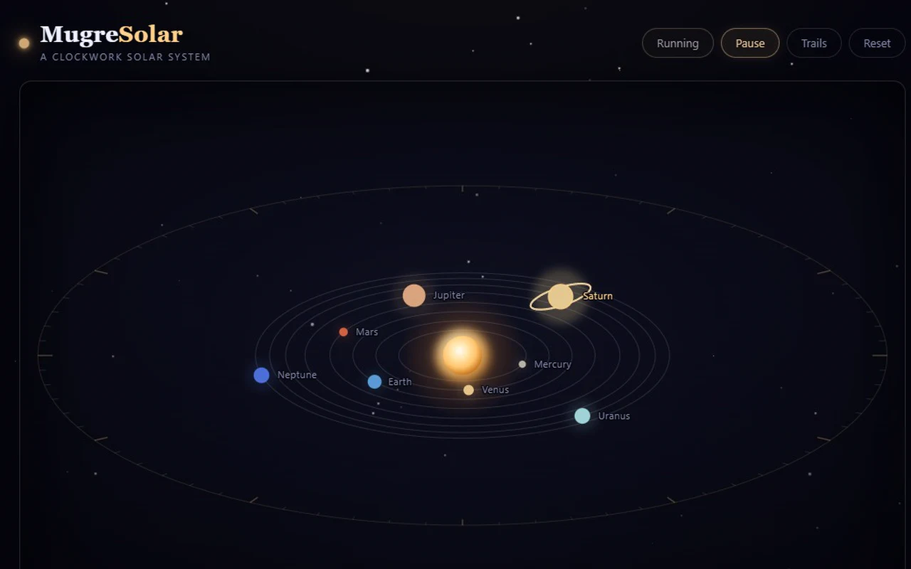

<meta property="og:title" content="MugreSolar — a clockwork solar system">
<meta property="og:description" content="Un reloj de sol en latón: orrery de los ocho planetas con períodos orbitales reales, hecho con un único HTML autocontenido.">
<meta property="og:image" content="https://raw.githubusercontent.com/Hugopvigo/SolarSystem/main/docs/capturas/preview.webp">

<p align="center">
  
</p>

<p align="center">
  <b>Un orrery de latón bajo una cúpula oscura.</b><br>
  Ocho planetas, períodos orbitales reales y distancias comprimidas para que quepan en un solo plato. Todo en un único archivo HTML.
</p>

<p align="center">
  <a href="https://hugopvigo.github.io/SolarSystem/"></a>
  
  
  
  
  
</p>

---

## Qué es esto

**MugreSolar** es un reloj de sol mecánico en miniatura: un sistema solar animado en SVG con estética de orrery de latón. La página es **completamente autocontenida**: CSS y JavaScript en línea, sin fuentes, imágenes, CDNs ni librerías externas. Abre `index.html` y funciona.

Las **órbitas se dibujan como elipses** para sugerir una vista inclinada del plato, con unidad de graduación perimetral y 70 estrellas parpadeantes fijas al fondo.

## Características

- **Períodos reales, distancias comprimidas.** La velocidad angular de cada planeta es inversamente proporcional a su período sidéreo medido: Mercurio da cuatro vueltas mientras la Tierra da una, y Neptuno apenas se mueve. Los radios están comprimidos para que los ocho quepan en el mismo plato.
- **Ocho mundos con identidad.** Cada planeta tiene su color, su etiqueta y su tamaño; Saturno lleva además su anillo elíptico.
- **Selección interactiva.** Al pulsar un planeta en el SVG o una fila de la lista *Bodies*, el cuerpo se agranda y el panel de hechos se reescribe con diámetro, número de lunas, duración del día y duración del año.
- **Controles de tiempo.** *Running / Pause* detienen o reanudan el mecanismo, *Trails* atenúa los anillos orbitales, *Reset* devuelve todos los ángulos a cero. Los deslizadores ajustan la velocidad orbital (0,05×–3×) y la escala del sistema (0,5×–2×) reconstruyendo las órbitas sin perder la selección.
- **Dos ensayos.** *Kepler's second law* y *Real periods, compressed distances* explican por qué el ritmo es fiel y la regla no.
- **Responsive.** Las dos columnas de paneles y ensayos se apilan por debajo de 920 px; la rejilla de hechos pasa a una sola columna por debajo de 520 px.
- **Accesibilidad.** Controles con `aria-*`, foco visible, navegación por teclado en la lista de planetas y respeto a `prefers-reduced-motion`.

## Períodos orbitales

| Planeta | Período (años) | Planeta | Período (años) |
|---|---|---|---|
| Mercurio | 0,24 | Júpiter | 11,9 |
| Venus | 0,62 | Saturno | 29,5 |
| Tierra | 1 | Urano | 84 |
| Marte | 1,88 | Neptuno | 164,8 |

## Uso

Abre `index.html` directamente en cualquier navegador moderno. No necesita servidor ni instalación.

Si prefieres servirlo localmente:

```bash
python -m http.server 8000
```

y visita `http://localhost:8000/`.

## Demo

Publicado con GitHub Pages en [hugopvigo.github.io/SolarSystem](https://hugopvigo.github.io/SolarSystem/).

## Licencia

[Creative Commons Attribution-NonCommercial-ShareAlike 4.0 International](LICENSE) — CC BY-NC-SA 4.0.

Hecho por **Hugo Perez-Vigo**.
